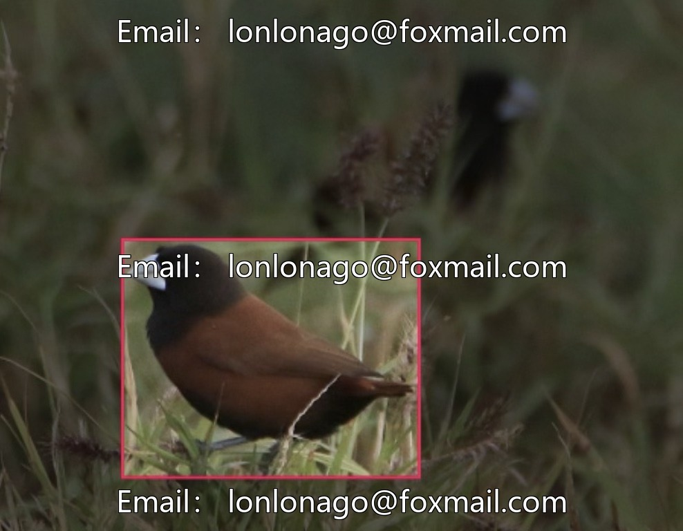

# Intelligent Wetland Bird Identification Dataset, Bird Classification Data, Including Chestnut-bellied Warbler and White-collared Sparrow

## Body

Intelligent Wetland Bird Identification Dataset, bird taxonomic data, including five categories such as Slender-tailed Sunbird, White-collar Oriole, Magpie, Tree Sparrow, Garden Sunbird, totaling 3947 bird images. Supports target detection tasks, suitable for research on species identification of birds.

The dataset format is an image file, which can be directly used for training computer vision models and is compatible with common analysis tools. Data covers 5 specific bird species, abundant in samples, avoiding single category bias, providing a foundation for bird identification model training and ecological monitoring.

Virtual materials, once sold, are non-refundable.
Interested friends, click "I want" to proceed.

## Images

## Payment

Here is a pay link on Stripe ( https://buy.stripe.com/3cs8yP7sY87d0vu9AB ). Please contact me lonlonago@foxmail.com after funding $89, and I will send you a complete data files , thank you!

